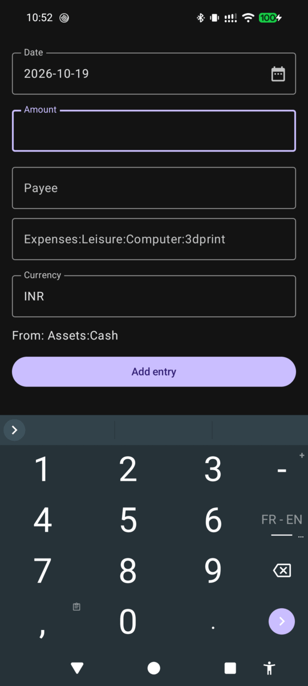
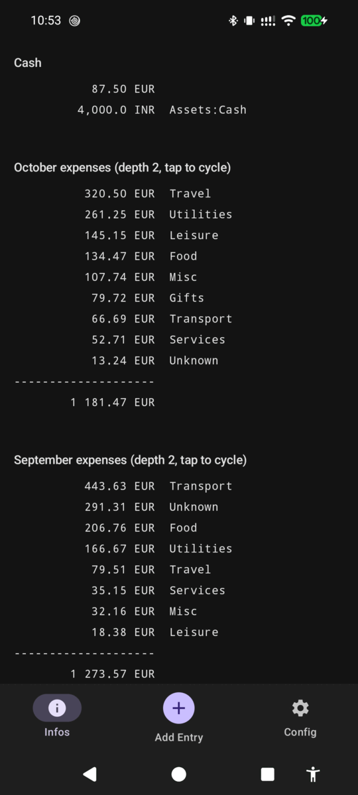
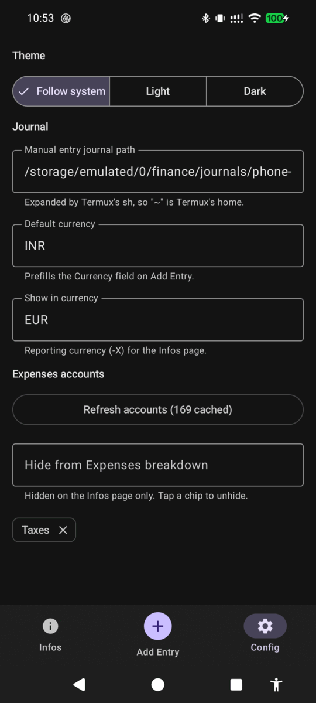

# Tally

Android app for adding [hledger](https://hledger.org) transactions and checking
balances on the go. It doesn't parse the journal itself: every read and write
goes through the real `hledger` CLI running in [Termux](https://termux.dev).

> [!NOTE]
> A personal, vibecoded project built for my own use. **No support is given**:
> no issue triage, no feature requests, no guaranteed fixes. If it doesn't do
> what you need, fork it and point an AI coding agent at it; the codebase is
> small enough for that to work well.

| Add entry | Infos | Config |
| :---: | :---: | :---: |
|  |  |  |

▶ [Demo video](media/demo.mp4) (32 s)

## Why

I wanted to record spending from my phone straight into my real hledger
journal, without exposing that journal to the network and without a second
parser that only understands part of it. The existing apps didn't fit:

- **MoLe** is a client for hledger-web's JSON API. hledger-web has no access
  control, so anything that can reach the server can read the journal and add
  to it. That means a server on a VPS or behind a VPN, or one on localhost in
  Termux, where any app on the phone with network access can reach the port.
- **NanoLedger** and its fork **MicroLedger** read and write the journal file
  with their own parser, which by their own READMEs "does not support the full
  (h)ledger syntax". Multi-file journals (`include`) and the rest of hledger's
  syntax only work properly with hledger itself.

Tally asks Termux to run `hledger` through Termux's `RUN_COMMAND` intent
instead. There's no server and no API, and the app has no internet permission.
The only permission it asks you for is Termux's `RUN_COMMAND`.

## How it works

- **Add Entry**: date, amount, payee, expense account and currency. The
  account field fuzzy-searches your `Expenses` accounts; leave it empty to
  reuse the last one. Entries are appended to a separate scratch journal,
  never to your main journal, so a bug here can't corrupt your ledger. Merge
  the scratch file into your journal by hand from time to time.
- **Infos**: your `Assets:Cash` balance, this and last month's `Expenses`
  (highest first, converted with `-X`; tap a month to cycle depth 2 → 3 → 4),
  and the scratch journal's entries, newest first. Pull to refresh; it also
  refreshes after each new entry.
- **Config**: theme, scratch journal path, default entry currency, reporting
  currency, a button to refresh the cached `Expenses` accounts, and accounts
  to hide from the monthly breakdowns (taxes, for example).

An added entry looks like this:

```
2026-10-19 vegetables
    Assets:Cash            -500 INR
    Expenses:Food:Grocery   500 INR
```

## Phone setup

1. Install [Termux](https://github.com/termux/termux-app#installation) from
   F-Droid or GitHub Releases. Avoid the Play Store build, which is
   experimental and missing features.
2. In Termux:
   ```sh
   pkg install hledger
   termux-setup-storage   # lets Termux use /storage/emulated/0
   echo 'allow-external-apps = true' >> ~/.termux/termux.properties
   termux-reload-settings
   ```
3. Point hledger at your main journal with a `~/.hledger.conf` containing a
   `-f /path/to/main.journal` line. A `LEDGER_FILE` exported in your shell
   profile isn't seen, because Termux runs Tally's commands without a login
   shell.
4. Install Tally from
   [Releases](https://github.com/lecler-i/hledger-tally-android/releases) and
   open it. Grant the "Run commands in Termux environment" permission when
   asked.
5. In **Config**, check the scratch journal path (default
   `/storage/emulated/0/finance/journals/phone-manual.journal`). Put it in a
   synced folder, with Syncthing for example, so entries reach your other
   machines.

## Other Android apps for hledger

As of October 2026:

| App | How it works | Latest release |
| --- | --- | --- |
| [MoLe](https://f-droid.org/packages/net.ktnx.mobileledger/) | Client for hledger-web's JSON API | 0.21.9, Aug 2026 |
| [NanoLedger](https://f-droid.org/packages/be.chvp.nanoledger/) | Data entry into one journal file, own parser, not the full syntax | 1.4.4, Jul 2026 |
| [MicroLedger](https://github.com/chrsrns/MicroLedger) | NanoLedger fork with a dashboard and templates, same parser | none published |
| [Cone](https://f-droid.org/packages/info.tangential.cone/) | Data entry into one journal file | 0.2.20, Mar 2020 |
| [Cashier](https://github.com/alensiljak/cashier) | Offline web app; imports through its own server, exports ledger text | none published |
| hledger in Termux | `hledger add` in the terminal: full hledger, typed by hand | |

Outside hledger, [Beanbook](https://github.com/pintofi/beanbook) takes the same
approach for Beancount by running the real Beancount and Fava on the phone.
hledger's [mobile page](https://hledger.org/mobile.html) also covers general
finance apps (GnuCash, MyExpenses, Money Manager Ex) whose exports can be
converted to a journal.

## Building

Open this folder in Android Studio, or run `./gradlew installDebug` with a
JDK 17+ and the Android SDK. Versions live in `gradle/libs.versions.toml`.

Release builds are signed with `app/release.p12` (gitignored), or left
unsigned when it's missing. CI decodes it from the base64
`HLEDGER_TALLY_KEYSTORE_BASE64` repository secret. Pushes to `main` publish a
release when `versionName` changes; other branches publish a `dev-<branch>`
prerelease.

## Project layout

```
app/src/main/java/dev/ghjkl/tally/
├── MainActivity.kt            — bottom-nav Scaffold, screen switching
├── data/
│   ├── AppSettings.kt         — settings (SharedPreferences, as Compose state)
│   └── Infos.kt               — Infos page content, kept across tab switches
├── termux/
│   ├── TermuxRunner.kt        — sends RUN_COMMAND, awaits the result via a
│   │                            PendingIntent-triggered Service
│   └── Hledger.kt             — the hledger invocations + output parsing
└── ui/
    ├── AccountSearchField.kt  — fuzzy-matched account dropdown
    ├── FuzzySearch.kt
    ├── RunCommandPermission.kt
    ├── theme/Theme.kt
    └── screens/
        ├── AddEntryScreen.kt
        ├── InfosScreen.kt
        └── ConfigScreen.kt
```

## Known limitations

- Merging the scratch journal into your main journal is manual, by design.
- Each entry is one cash payment into one `Expenses` account: no transfers or
  split postings.
- Needs Termux installed with `RUN_COMMAND` granted. If Termux changes its
  result format, `TermuxRunner.kt` needs updating.

## License

[Unlicense](LICENSE): public domain. Do whatever you want with it.
